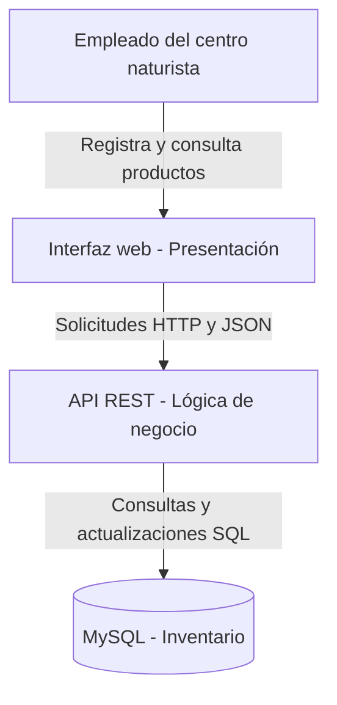

# Vista C4 de contenedores — Centro Naturista

**Estado:** Diseño propuesto, no implementado.

## Descripción
El empleado utiliza la interfaz web para registrar productos naturales, consultar existencias y actualizar cantidades. La interfaz envía solicitudes HTTP a la API REST, donde se aplican las reglas de negocio. La API accede a MySQL para consultar y almacenar los datos.

## Decisiones relacionadas
- ADR-001: Separación en capas.
- ADR-002: Persistencia en MySQL.
- ADR-003: Comunicación mediante API REST.

## Alcance de la evidencia
Este diagrama representa la arquitectura propuesta y no constituye evidencia de una implementación funcional.
